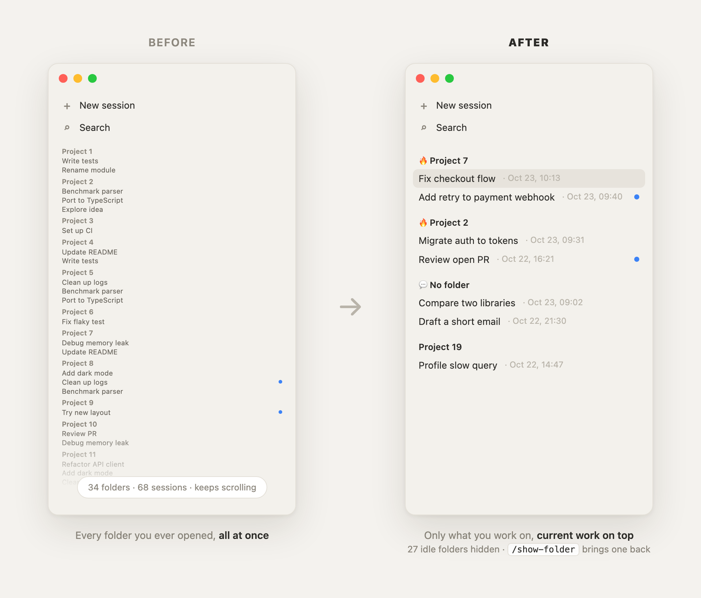

# Focus Sidebar

A Claude Code mod for Claude Desktop that keeps the Code sidebar down to what you are working on.

<picture>
  <source media="(prefers-color-scheme: dark)" srcset="docs/images/hero-dark.png">
  
</picture>

- **One section per project.** Sessions are filed by folder (the git repo root, so subfolders and worktrees land
  together); sessions with no folder go to «💬 No folder», sessions in your home folder to «🏠 Home».
- **What you are on now, on top.** Folders worked in during the last hour come first, marked 🔥, newest first; the
  rest follow by activity (every session counts, recent ones weigh more).
- **Who needs you first.** A section with three or more sessions is grouped by state, so the ones waiting for your
  answer come first («💬 No folder» is grouped by day); smaller sections stay a plain list.
- **When you last worked on it.** Each session title ends with the date and time of its last activity,
  `Fix checkout flow · Oct 23, 10:13`, in your own time zone, and is updated when the session comes back to life.
- **Idle folders disappear.** A folder you left out of a full working day is hidden as a whole: its sessions move to
  the app's Archived list. Days you did not work at all do not count, so a weekend hides nothing. Nothing is
  deleted, and each no-folder session counts as its own folder. An idle session the app will not archive (one
  waiting for your answer) goes to «🧊 Archive» at the bottom instead.
- **Folders come back on their own.** Start working in a hidden folder again and its other sessions return with it.
- **Or bring one back by hand.** `/show-folder` lists the hidden folders, `/show-folder <name>` restores one.
- **Hands off what you arranged.** Pinned sessions, nested sessions, routine runs and sessions you filed into your
  own sections stay where they are.

## Install

In a terminal Claude Code session:

```
/plugin install focus-sidebar --marketplace zigansh1n/claude-focus-sidebar
```

Answer `y` to add the marketplace and pick the **user** scope. Or from a shell:

```bash
claude plugin install focus-sidebar --marketplace zigansh1n/claude-focus-sidebar
```

In the desktop app: click **+** next to the prompt box, then **Plugins**, **Add marketplace** with
`zigansh1n/claude-focus-sidebar`, then **Add plugin**.

The mod starts working in the next Claude Desktop session you open or resume. It needs a Claude Code build with
hooks modules (mods); if nothing happens, see `claude --debug` for a `hooks module focus-sidebar ... loaded` line.

## How it works

The sidebar has no call to reorder sections, but a renamed section keeps its place and a new one is added after
the other custom sections. So the mod owns a run of "slot" sections and renames them by rank instead of moving
them. It syncs 5 s after a session starts, 2 s after each turn and every 5 minutes; a short lease keeps several
open sessions from syncing at once. Log: `~/.claude/focus-sidebar.log`.

## Test

```
claude plugin test .
```

## License

MIT

The pictures are rendered from [docs/render/sidebar.html](docs/render/sidebar.html).
